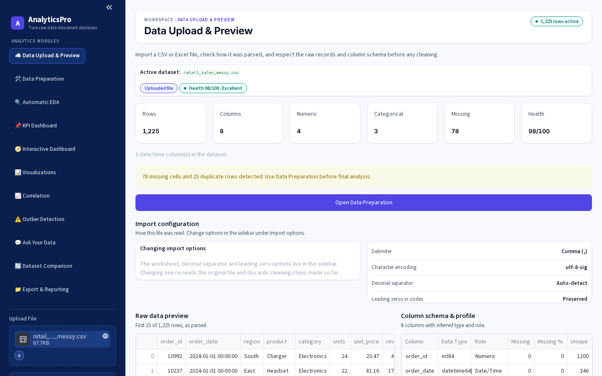
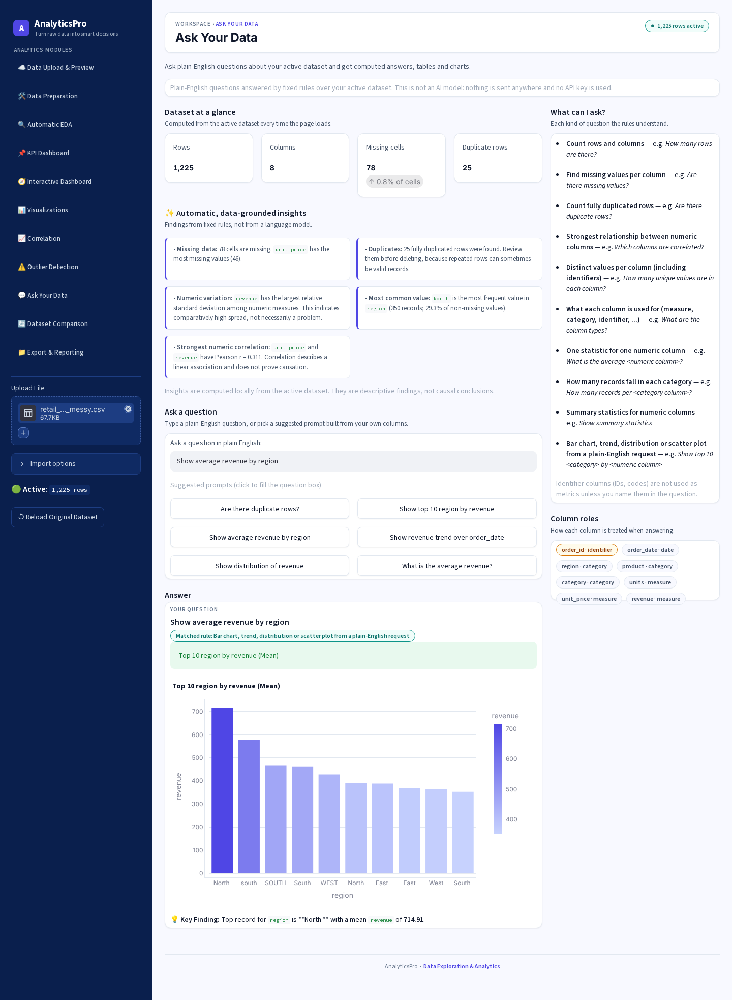
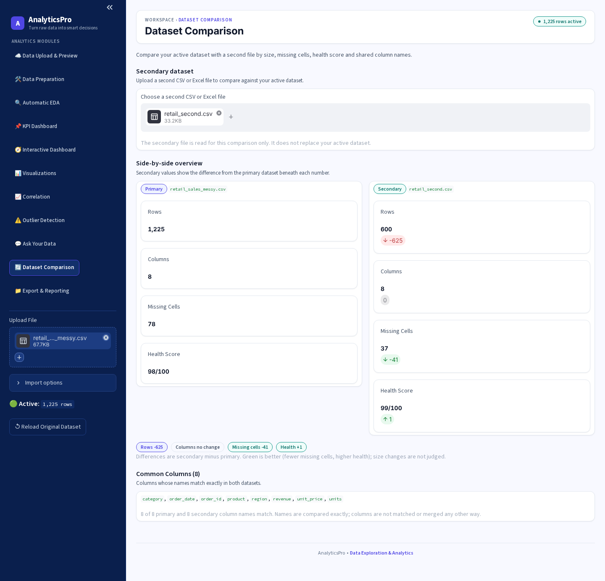
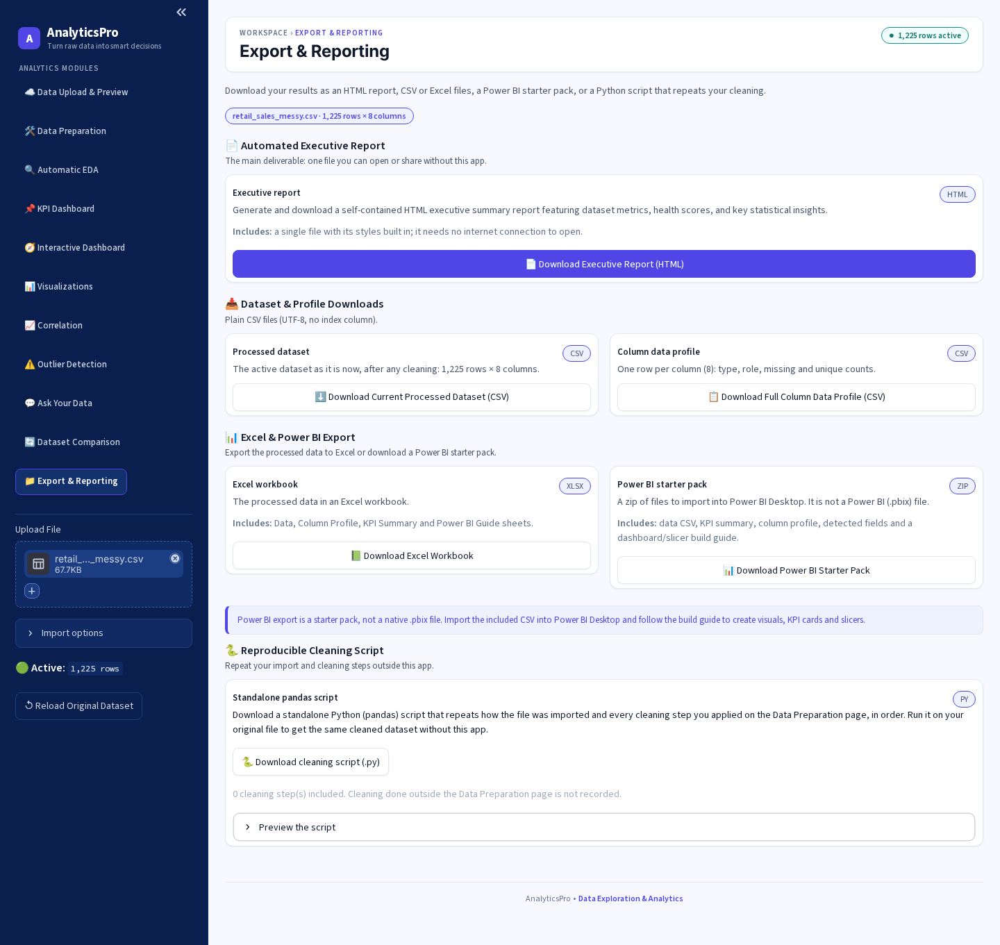
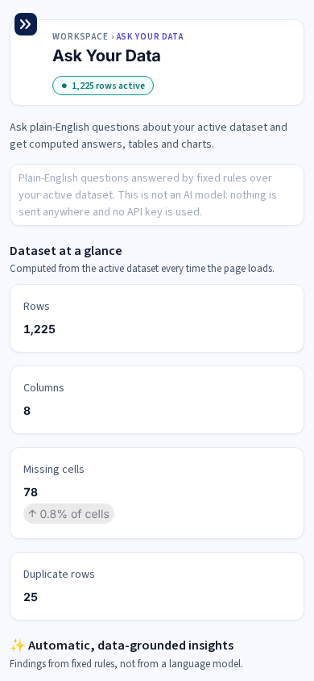

# AnalyticsPro

A Streamlit app for exploring and cleaning tabular data (CSV and Excel) **without writing code**: upload a file, repair it step by step with a visible audit trail, profile it, chart it, compare it with another file, and export the result.

**Who it is for:** students, analysts-in-training and small-business users who work in spreadsheets and want guided cleaning plus quick exploratory analysis in a browser.
**What it is not:** an AI product. The "Ask Your Data" page is rule-based keyword matching over your own dataset (no language model, no network calls, no API key), and there is no database, login or multi-user support. Data lives only in your browser session.



## Features

| Page | What it does |
|---|---|
| Data Upload & Preview | Load CSV / XLSX / XLS, auto-detect delimiter and encoding, preview rows and per-column summary. **Import options:** choose the Excel worksheet, the decimal separator (auto / point / comma) and whether codes with leading zeros stay text; a list of anything the importer changed is shown as *Import notes* |
| Data Preparation | Missing values, duplicates, column drop/rename/reorder, type conversion, text clean-up, infinite values, date parts, before/after comparison, a timestamped cleaning history, and two reset options (back to the session checkpoint, or to the original upload) |
| Automatic EDA | Dataset health score, plain-language insights, distributions, missing-value analysis |
| KPI Dashboard | Headline metrics for the *whole* dataset: a chosen numeric column, a category breakdown and a trend, with no setup |
| Interactive Dashboard | Card-style dashboard (navy sidebar with highlighted page, KPI cards with icons and change-vs-full-dataset, a composition donut with legend, a data-quality checklist, a completeness ring, latest records and a segment chart) for a *slice* of the data: category, date and numeric-range filters update your own KPI cards, any combination of 10 chart types, the Smart Dashboard Builder and the filtered table together; filtered CSV/Excel export |
| Visualizations | Build **one** chart at a time with styling control (palette, height, grid): bar, line, area, pie, histogram, box, violin, scatter; plus "smart recommendations" derived from the actual columns |
| Correlation & Relationships | Correlation heatmap (selectable method and colour scheme), a table of relationships above an adjustable threshold, and a pairwise scatter inspector |
| Outlier Detection | IQR or z-score detection with adjustable thresholds, box plot, distribution with bounds, and a table of the outlier records (first 100) |
| Ask Your Data | Plain-English questions answered by fixed rules over the active dataset: row counts, missing values, duplicates, column types, one statistic of one column, records per category, summaries, and chart requests. Suggested prompts come from your real columns and never use ID columns as metrics. Rule-based; runs locally; no AI service is called |
| Dataset Comparison | Side-by-side row/column/missing/health metrics and common columns for two files |
| Export & Reporting | Six downloads: HTML executive report, cleaned CSV, column-profile CSV, Excel workbook, Power BI starter pack (a ZIP of data and build guide, not a native `.pbix`), and a **reproducible cleaning script**: a standalone pandas `.py` file that repeats how your file was imported and every cleaning step you applied, so the result can be re-created without the app |

Cleaning protections: a type conversion that would turn real values into missing ones is refused unless you tick an explicit box; an invalid custom fill value is rejected rather than silently replaced by 0; the original upload is never modified.

## Screenshots

Genuine screenshots of all 11 pages at desktop (1440 px), tablet (820 px) and mobile (390 px) width are in [`screenshots/`](screenshots/) (`desktop/`, `tablet/`, `mobile/`; `*_full.png` shows the whole page), plus `states/` (empty state, an answered question, a loaded comparison). They were captured from the running app with `scripts/release_screenshots.py` on the sample data. Emulated devices only; no physical phone or tablet was used. The older images in `docs/screenshots/` pre-date the redesign and are kept only for history.






## Technology stack

| Layer | Used |
|---|---|
| App framework | Streamlit 1.66.1 (single-page app, custom navy-sidebar navigation and shared CSS design tokens in `views/common.py`) |
| Data | pandas 3.0.5, NumPy 2.5.2, PyArrow 25.0.1 |
| Charts | Plotly 7.0.0 (OLS trendline via the optional `statsmodels`; native `st.bar_chart` for table answers) |
| File formats | CSV (several delimiters/encodings), `.xlsx` (openpyxl 3.1.5), legacy `.xls` (xlrd) |
| Quality tooling | pytest, ruff, pyflakes, mypy, Playwright (browser tests and screenshots), coverage, pip-audit |

No database, no network service, no AI/LLM and no API key: everything runs locally in your Python process.

## The 11 screens

1. Data Upload & Preview, 2. Data Preparation, 3. Automatic EDA, 4. KPI Dashboard, 5. Interactive Dashboard, 6. Visualizations, 7. Correlation & Relationships, 8. Outlier Detection, 9. Ask Your Data, 10. Dataset Comparison, 11. Export & Reporting. The table above describes each one.

## Quick start

Requires **Python 3.12 or newer** (the pinned NumPy needs it). Developed and tested on 3.12; 3.13 is configured in CI but has not been run yet.

```bash
git clone <your-repo-url> && cd AnalyticsPro
python -m venv .venv
# Windows (PowerShell): .venv\Scripts\Activate.ps1      macOS/Linux: source .venv/bin/activate
pip install -r requirements.txt
cd phase4
streamlit run app.py
```

The app opens at http://localhost:8501. Keep the project outside OneDrive/Dropbox-synced folders when creating the virtual environment.

## Configuration

Settings live in `phase4/.streamlit/config.toml` and apply when you start the app from `phase4/`:

| Setting | Value | Meaning |
|---|---|---|
| `server.maxUploadSize` | 200 | Largest accepted file, in MB (whole file is held in memory) |
| `browser.gatherUsageStats` | false | No anonymous usage statistics |
| `client.showErrorDetails` | "type" | Only the exception type is shown on the page, not stack traces |
| `theme.primaryColor` | `#4f46e5` | Brand indigo for sliders, radios and tags |

To use another port: `streamlit run app.py --server.port 8600`. Runtime dependencies are pinned in `requirements.txt` (see the comments there for the optional `statsmodels` and the `xlrd` needed for `.xls`); test and tooling dependencies are in `requirements-dev.txt`. There are no environment variables or secrets.

## Try it with the sample data

`sample_data/` holds three **synthetic** files (random values from a fixed seed; no real people or organisations). Regenerate them with `python sample_data/make_sample_data.py`.

| File | Why it is interesting |
|---|---|
| `retail_sales_messy.csv` | 1,225 rows with missing numbers and text, 25 duplicate rows, inconsistent spacing/case in `region`, and a few extreme revenue values: a realistic cleaning exercise |
| `weather_stations_numeric.csv` | Numeric only, with a column named `humidity` (whose name contains "id" but is a measurement) |
| `employees_semicolon.csv` | Semicolon-delimited, as exported by many European spreadsheets |

**Example workflow** (with `retail_sales_messy.csv`): upload it, open *Data Preparation* and run **Quick Auto-Clean** (or treat missing values and duplicates individually); check *Before vs After*; look at *Automatic EDA* and *Outlier Detection* (the inflated revenue rows show up); build a chart on *Visualizations*; then, on *Export & Reporting*, download the report and the **cleaning script** (run it with `python retail_sales_messy_cleaning_script.py` after placing the original CSV next to it to re-create the cleaned file without the app).

## Project layout

```
phase4/
  app.py            Entry point: page config, styling, navigation, upload and routing
  views/            One module per page (upload, data_prep, eda, kpi, visualizations, correlation,
                    outliers, interactive_dashboard, analyst, comparison, export) plus common helpers
  data/             Pure logic, no Streamlit imports, type-checked with mypy and unit-tested
    loader.py         read CSV/Excel, delimiter/encoding/dates, leading zeros, decimal commas, worksheets
    aggregation.py    ONE definition of Sum/Average/Median/Count/Min/Max (used by every page)
    columns.py        column roles: measure, category, identifier, date, text, ...
    charts.py         ONE chart builder with validation and friendly messages
    analyst.py        Ask Your Data: routing, answers, schema-aware suggestions
    intent.py         chart-request parsing used by the analyst
    cleaner.py        missing values, duplicates, type conversion, text/numeric clean-up
    validator.py      dataset and conversion checks
    profiler.py       metrics, health score, statistics, outlier detection, insights
    recommender.py    chart recommendations and chart-data helpers
    script_export.py  turns the import + cleaning history into a standalone pandas script
    dashboard_cards.py  numbers for the dashboard cards (KPI deltas, composition, quality checks)
    report.py         HTML executive report (all user text is escaped)
    export.py         CSV/Excel bytes and safe download names
  utils/            helpers, Arrow-safe dataframes, session-state management
  tests/            pytest suites (unit, Streamlit AppTest, real-browser)
sample_data/        synthetic demo datasets + generator
scripts/            chart-matrix generator, make_screenshots.py (older docs images), release_e2e.py (browser workflow check),
                    release_screenshots.py (all pages x 3 widths + overflow/exception check)
screenshots/        release screenshots (desktop, tablet, mobile, states)
FINAL_RELEASE_REPORT.md  final integration and validation report
docs/               scorecard, change and validation reports, matrices, decisions, history
archive/                             original Colab prototype notebook (not used by the app; see docs/NOTEBOOK.md)
```

Dependency rule: `app.py` -> `views/` -> `data/` and `utils/`; `data/` never imports Streamlit and never imports `app.py`.

Supported inputs: `.csv` (comma, semicolon, tab or pipe delimited; UTF-8, UTF-8 with BOM, Windows-1252, Latin-1), `.xlsx`, `.xls` (one worksheet at a time). Maximum upload 200 MB (`phase4/.streamlit/config.toml`).

## Tests

```bash
pip install -r requirements-dev.txt
cd phase4
python -m pytest -m "not browser"                  # unit + Streamlit AppTest, about 2 minutes
coverage run --source=data,utils -m pytest -m "not browser" && coverage report
python -m pyflakes app.py views data utils tests && ruff check app.py views data utils
python -m mypy app.py views data utils --ignore-missing-imports
python -m playwright install chromium              # once, for the browser tests
RUN_BROWSER_TESTS=1 python -m pytest tests/browser -m browser   # contrast, sidebar, real downloads (opt-in)

# Optional full workflow check through a real browser (app must be running on port 8501;
# the .xlsx needs two sheets: the CSV data first, then a 50-row sheet named "Small")
python scripts/release_e2e.py http://localhost:8501 sample_data/retail_sales_messy.csv two_sheets.xlsx other.csv
```

**Latest verified results** (final release validation, extracted release ZIP, fresh virtual environment, Python 3.12.3, Streamlit 1.66.1): `pytest -m "not browser"` **959 passed, 0 failed** (5 browser tests deselected); browser tests **5 passed, 0 failed**; end-to-end workflow script **44/44 checks passed**; ruff, pyflakes and mypy (34 files) clean; app starts and `/_stcore/health` returns `ok`. **Not run in the final validation:** coverage, `pip-audit`, Python 3.13 and the GitHub Actions workflow (the coverage and audit figures quoted in older docs such as `docs/VALIDATION_REPORT.md` are historical). Full details, including bugs found and what was not tested: [FINAL_RELEASE_REPORT.md](FINAL_RELEASE_REPORT.md).

Every chart type is tested against every supported kind of column; see the generated [chart compatibility matrix](docs/CHART_COMPATIBILITY_MATRIX.md).

## Known limitations

- **Type and ID detection are heuristics.** Whole-number columns are treated as identifiers when named like one (`id`, `code`, `key`...) or when they count up in sequence; an ID column with random values and an innocent name looks like a measure. `Ask Your Data` can still analyse any column you name explicitly.
- **Decimal commas:** `12,50` and `1.234,56` convert automatically; values such as `1,234` are ambiguous and stay text until you pick a decimal setting under *Import options*. A column mixing formats is left alone.
- **Leading zeros** are kept for digit-only columns that contain at least one value starting with `0`. Numbers formatted with leading zeros in Excel (a number cell displayed as `00123`) are stored as 123 by Excel itself and cannot be recovered.
- The whole file is held in memory, with extra copies while cleaning. 300,000 rows x 8 columns (25 MB) loads in about 1 s; larger files were not measured.
- Pages overlap on purpose but have distinct jobs (see [docs/FEATURE_OWNERSHIP_MATRIX.md](docs/FEATURE_OWNERSHIP_MATRIX.md)).
- Browser testing was done in headless Chromium only (emulated tablet and phone sizes). Firefox, Safari, real devices, keyboard-only use and screen readers are untested.
- On phone-width screens the sidebar stays open over the page after you pick a page; close it with the arrow at the top-left. On tablet width, rows of four metric cards can truncate long labels.
- Plotly's hover toolbar can overlap chart titles on phone-width screens. Outlier Detection and Correlation start on the first numeric column, which may be an identifier such as `order_id`; choose another column.
- The sidebar renders at Streamlit's default width (300 px); a 248 px width rule in the stylesheet keys on `aria-expanded`, which Streamlit 1.66.1 does not set, so it does not apply.
- Dependencies are pinned to Streamlit 1.66.1 with Pillow 13 (the earlier Streamlit 1.63.0 / Pillow 12 pair had 37 advisories). The full suite was run on this pair, but a user's own environment may resolve other versions if the pins are loosened.

## Documentation

Current: [Scorecard](docs/PROJECT_SCORECARD.md) · [Change report](docs/CHANGE_REPORT.md) · [Validation report](docs/VALIDATION_REPORT.md) · [Chart matrix](docs/CHART_COMPATIBILITY_MATRIX.md) · [Feature ownership](docs/FEATURE_OWNERSHIP_MATRIX.md) · [Feature decisions](docs/FEATURE_DECISIONS.md) · [Notebook](docs/NOTEBOOK.md) · [License decision](docs/LICENSE_DECISION.md)

History: [Project history](docs/HISTORY.md) (how the project evolved; older detailed reports were removed because they no longer matched the code).

## License

This project is Licence under the MIT Licence.see the [LICENCE](LICENCE) file for details.